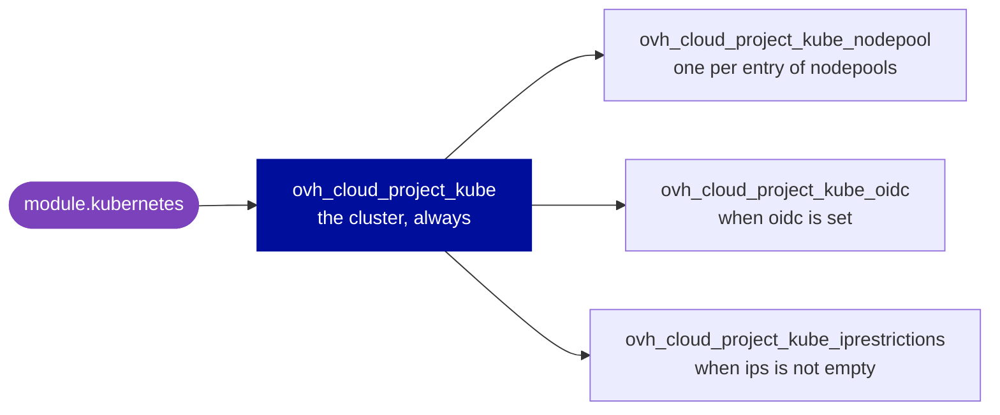

# terraform-ovh-kubernetes

[](CHANGELOG.md)
[](#requirements)
[](https://registry.terraform.io/providers/ovh/ovh/latest)
[](LICENSE)

**A managed Kubernetes cluster (MKS) on OVHcloud in one module block: the
cluster, its node pools, OIDC and the IP restrictions of its API server.**

- 🧩 **The provider, unchanged.** Every input keeps its provider attribute
  name, but `kubernetes_version`: Terraform reserves `version`. If you know
  `ovh/ovh`, you already know this module.
- 🌐 **Public or private.** A public cluster with no network input, or one in
  a private network (vRack), with its subnets and gateway.
- 🧱 **Node pools by name.** One entry per node pool, with autoscaling,
  anti-affinity, monthly billing, and the labels, taints and annotations of
  its nodes.
- ✅ **Caught at plan, not at apply.** A name of the wrong length, a version
  other than `X.Y`, an unknown update policy or anything but an IPv4 CIDR in
  `ips` fails before OVHcloud sees it.

> [!IMPORTANT]
> Destroying the module, or changing `region`, `kube_proxy_mode` or
> `private_network_id`, deletes the cluster with its etcd data: every
> Kubernetes object in it. Read [Watch out](#watch-out) before your first
> apply.

**[Quick start](#quick-start)** · **[Inputs](#inputs)** ·
**[Outputs](#outputs)** · **[Watch out](#watch-out)** ·
**[Guides](#guides)** · **[Requirements](#requirements)**

## Quick start

**1. Create API credentials** for your OVHcloud account, able to manage the
Public Cloud project of the cluster, and export them with the API endpoint,
such as `ovh-eu`:

```bash
export OVH_ENDPOINT=ovh-eu OVH_CLIENT_ID=... OVH_CLIENT_SECRET=...
```

The provider also takes an application key, an application secret and a
consumer key, in `OVH_APPLICATION_KEY`, `OVH_APPLICATION_SECRET` and
`OVH_CONSUMER_KEY`, instead of the OAuth2 client.

**2. Call the module:**

```hcl
module "kubernetes" {
  source = "git::https://github.com/theobs-digital/terraform-ovh-kubernetes.git?ref=v2.0.0"

  service_name       = "your-ovh-project-id"  # the Public Cloud project ID
  name               = "my-cluster"
  kubernetes_version = "1.32"
  region             = "GRA7"

  nodepools = {
    default = { flavor_name = "b3-8" }
  }
}

output "kubeconfig" {
  value     = module.kubernetes.kubeconfig
  sensitive = true
}
```

**3. Apply, then connect.** The `kubeconfig` output is the kubeconfig file of
the cluster. Terraform prints a sensitive output when you name it:

```bash
terraform output -raw kubeconfig > kubeconfig.yml
KUBECONFIG=kubeconfig.yml kubectl get nodes
```

The file holds the client certificate and key of the cluster: keep it out of
version control.

> [!TIP]
> `?ref=v2.0.0` pins the module to its release `v2.0.0`. Always set `ref` to
> a tag: without it, Terraform takes the latest commit of the default branch.

More in the examples: [basic](examples/basic) (one node pool, the module's
defaults for the rest), [complete](examples/complete) (a private network,
admission plugins, OIDC, IP restrictions and two autoscaled node pools) and
[import](examples/import) (an existing cluster brought under the module).

### How it works

Each input drives one provider resource, or a block of the cluster. Leave an
input out, and the module creates nothing for it.



`customization_apiserver`, `customization_kube_proxy` and
`private_network_configuration` are blocks of the cluster, sent only when
they hold a value.

## Inputs

| Input | Type | Default | Description |
|---|---|---|---|
| `service_name` | `string` | **required** | ID of the Public Cloud project |
| `name` | `string` | **required** | name of the cluster, 5 to 63 characters |
| `kubernetes_version` | `string` | **required** | a minor release, such as `1.32` |
| `region` | `string` | **required** | region of the cluster, such as `GRA7` |
| `plan` | `string` | `"free"` | `free` or `standard` |
| `kube_proxy_mode` | `string` | `"iptables"` | `iptables` or `ipvs` |
| `update_policy` | `string` | `null` | `ALWAYS_UPDATE`, `MINIMAL_DOWNTIME` or `NEVER_UPDATE` |
| `private_network_id` | `string` | `null` | the private network (vRack), see [Private network](#private-network) |
| `nodes_subnet_id` | `string` | `null` | subnet of the nodes |
| `load_balancers_subnet_id` | `string` | `null` | subnet of the public load balancers |
| `private_network_configuration` | `object` | `null` | gateway and routing of the private network |
| `customization_apiserver` | `object` | `{}` | admission plugins, see [Customization](#customization) |
| `customization_kube_proxy` | `object` | `{}` | iptables or IPVS settings of kube-proxy |
| `oidc` | `object` | `null` | login through an OIDC provider, see [OIDC](#oidc) |
| `ips` | `list(string)` | `[]` | CIDRs allowed to reach the API server, see [IP restrictions](#ip-restrictions) |
| `nodepools` | `map(object)` | `{}` | node pools by name, see [Node pools](#node-pools) |

Each block below lists every attribute an input takes, with what it does.
Attributes keep their provider names, and whatever you leave out keeps
OVHcloud's default, but where the module sets its own: `plan`,
`kube_proxy_mode`, and the size and options of a node pool.

> [!WARNING]
> **A misspelled attribute is dropped without a word.** Terraform discards
> the attributes an object input does not declare: `autoscal = true` leaves
> the node pool without autoscaling, and the plan shows no error. Check the
> names against the blocks on this page.

### Cluster

```hcl
# Required.
service_name       = "your-ovh-project-id"  # changing it replaces the cluster
name               = "my-cluster-prod"      # 5 to 63 characters
kubernetes_version = "1.32"                 # changing it updates the cluster in place
region             = "GRA7"                 # such as GRA7, SBG5 or BHS5; changing it replaces the cluster

# Optional. plan and kube_proxy_mode show the module's defaults.
plan            = "free"              # or standard
kube_proxy_mode = "iptables"          # or ipvs; changing it replaces the cluster, with its etcd data
update_policy   = "MINIMAL_DOWNTIME"  # ALWAYS_UPDATE, MINIMAL_DOWNTIME or NEVER_UPDATE
```

**`name`** takes 5 to 63 characters, as the OVHcloud console allows: the
module refuses any other length at plan, since the provider checks nothing.

**`kubernetes_version`** takes a minor release, such as `1.32` or `1.33`, as
MKS expects. The provider takes any string, so the module refuses any other
format at plan, such as `v1.32.0`.

**`plan`** is `free` or `standard`. The provider's documentation says that
moving a cluster to another plan is not implemented yet, and creates its
multi-zone cluster on `standard`, see
[Spread the nodes over three zones](#spread-the-nodes-over-three-zones).

**`update_policy`** takes one of three values, which the module checks at
plan: the provider lets any value through, and the API refuses it only at
apply. Leave it out, and the module leaves it to OVHcloud.

### Private network

Leave these inputs out for a public cluster.

```hcl
private_network_id       = "xxxxxxxx-xxxx-xxxx-xxxx-xxxxxxxxxxxx"  # changing it replaces the cluster, with its etcd data
nodes_subnet_id          = "xxxxxxxx-xxxx-xxxx-xxxx-xxxxxxxxxxxx"  # set at creation only; default: the first subnet of the network
load_balancers_subnet_id = "xxxxxxxx-xxxx-xxxx-xxxx-xxxxxxxxxxxx"  # public load balancers; default: the subnet of the nodes

private_network_configuration = {
  default_vrack_gateway              = "10.0.0.1"  # egress traffic goes through this address of the network; "" disables it
  private_network_routing_as_default = true        # route through the nodes' private interface, not their public one
}
```

`private_network_id` is the OpenStack ID of the network in the region of the
cluster, which the provider's examples take from an
`ovh_cloud_project_network_private` resource:
`tolist(ovh_cloud_project_network_private.network.regions_attributes[*].openstackid)[0]`.
Both subnets must belong to that network, and neither works without
`private_network_id`. `nodes_subnet_id` cannot be updated: it is only read at
the creation of the cluster, or at a reset.

`private_network_configuration` takes both attributes. To use the gateway
that the subnet advertises by DHCP, set `default_vrack_gateway = ""` and
`private_network_routing_as_default = true`.

### Customization

```hcl
customization_apiserver = {
  admissionplugins = {
    enabled  = ["NodeRestriction"]   # only NodeRestriction and AlwaysPullImages can be enabled
    disabled = ["AlwaysPullImages"]  # only AlwaysPullImages can be disabled
  }
}

# Durations in the RFC 3339 format, such as PT60S.
customization_kube_proxy = {
  iptables = {
    sync_period     = "PT30S"  # how often the rules are refreshed
    min_sync_period = "PT1S"   # greater than 0
  }
  ipvs = {
    sync_period     = "PT30S"
    min_sync_period = "PT1S"
    scheduler       = "rr"    # the IPVS scheduler
    tcp_timeout     = "PT0S"  # idle TCP sessions; PT0S keeps the system's value
    tcp_fin_timeout = "PT0S"  # TCP sessions after a FIN; PT0S keeps the system's value
    udp_timeout     = "PT0S"  # UDP packets; PT0S keeps the system's value
  }
}
```

OVHcloud enables `NodeRestriction` and `AlwaysPullImages` by default, and
disables none. With both lists empty, the module sends no
`customization_apiserver` block; without `iptables` and `ipvs`, no
`customization_kube_proxy` block.

### OIDC

Users log in to the cluster through an OpenID Connect provider, such as Dex,
Keycloak, Microsoft Entra ID (Azure AD) or Google.

```hcl
oidc = {
  client_id  = "my-k8s-client"                       # required
  issuer_url = "https://auth.example.com/realms/k8s"  # required

  oidc_username_claim  = "email"             # default sub; a claim other than email is prefixed with the issuer URL
  oidc_username_prefix = "oidc:"             # oidc:jane.doe; "-" disables every prefix
  oidc_groups_claim    = ["groups"]          # claims holding the user's groups, an array of strings
  oidc_groups_prefix   = "oidc:"             # oidc:engineering
  oidc_required_claim  = ["hd=example.com"]  # key=value pairs the ID token must hold
  oidc_signing_algs    = ["RS256"]           # the default
  oidc_ca_content      = "LS0tLS1CRUdJTi..." # base64 CA of the identity provider's certificate; default: the host's root CAs
}
```

Without `oidc_username_prefix`, a username claim other than `email` is
prefixed with `issuer_url`. Removing `oidc` deletes the OIDC configuration of
the cluster.

### IP restrictions

```hcl
ips = ["203.0.113.0/24", "198.51.100.0/24"]
```

The API server then answers only these networks: list those that `kubectl`
and the `kubernetes` or `helm` providers connect from. Leave `ips` empty, and
the module creates no restriction. The module refuses anything but IPv4
CIDRs at plan: the provider lets any string through, and the restrictions
come after the cluster, so a bad CIDR would leave it open until the next
apply.

### Node pools

`nodepools` is a map, keyed by the node pool's name: the provider forbids
`_` in it, and [renaming a key](#rename-a-key) replaces the node pool. Here
is every attribute a node pool takes; a real one sets only those it needs,
as in [Quick start](#quick-start).

```hcl
nodepools = {
  general = {
    flavor_name = "b3-8"  # required: a Public Cloud flavor; changing it replaces the node pool

    # The values shown are the module's defaults.
    desired_nodes      = 1      # between min_nodes and max_nodes
    min_nodes          = 1
    max_nodes          = 3
    autoscale          = false
    availability_zones = []     # one zone; required on a multi-zone cluster
    monthly_billed     = false  # changing it replaces the node pool
    anti_affinity      = false  # changing it replaces the node pool

    # The autoscaler: when a node can be removed.
    autoscaling_scale_down_unneeded_time_seconds = 600   # unneeded for that long
    autoscaling_scale_down_unready_time_seconds  = 1200  # unready for that long
    autoscaling_scale_down_utilization_threshold = 0.5   # requested resources over capacity below this

    # Applied to each node of the pool.
    template = {
      metadata = {
        labels      = { workload = "general" }
        annotations = { "example.com/owner" = "platform" }
        finalizers  = []  # fully qualified, such as kubernetes.io/pv-protection
      }
      spec = {
        unschedulable = false
        taints        = [{ key = "dedicated", value = "general", effect = "NoSchedule" }]  # NoExecute, NoSchedule or PreferNoSchedule
      }
    }
  }

  gpu = {
    flavor_name    = "t2-45"
    desired_nodes  = 1
    min_nodes      = 0
    max_nodes      = 3
    autoscale      = true
    monthly_billed = true
    template = {
      metadata = { labels = { workload = "gpu" } }
      spec     = { taints = [{ key = "nvidia.com/gpu", value = "true", effect = "NoSchedule" }] }
    }
  }
}
```

`desired_nodes` must stay between `min_nodes` and `max_nodes`, or the
provider raises an error: with the module's defaults, 1 to 3 nodes.
`availability_zones` takes one zone at the moment.

## Outputs

| Output | Use it for |
|---|---|
| `kubeconfig` | 👉 `kubectl` and the other Kubernetes clients: the kubeconfig file, sensitive |
| `kubeconfig_attributes` | 👉 the `kubernetes` and `helm` providers: `host`, and the certificates and key in base64, sensitive. See [Connect the Kubernetes providers](#connect-the-kubernetes-providers) |
| `kube_id` | the resources and OVHcloud API calls that act on the cluster |
| `kube_version` | the Kubernetes version of the cluster, for the clients that must match it |
| `kube_status` | `READY` once the cluster is up |
| `nodepools` | the ID, flavor, node counts, status and autoscaling of each node pool, by key of `nodepools` |

> [!NOTE]
> Terraform keeps the kubeconfig, its client key included, in the state in
> clear text, as every sensitive value: protect the backend.

## Watch out

**🔴 Can delete data or lock users out**

- **Destroying the module, or changing `service_name`, `region`,
  `kube_proxy_mode` or `private_network_id`**, deletes the cluster with its
  etcd data, every Kubernetes object in it; a change then creates a new
  cluster. Before applying, look for `module.kubernetes.ovh_cloud_project_kube.this`
  in the plan.
- **Renaming a key of `nodepools`, or changing `flavor_name`,
  `monthly_billed` or `anti_affinity` of a node pool**, replaces it: its nodes
  are deleted, then new ones created. See [Rename a key](#rename-a-key).
- **Importing a cluster with an input left at the module's default**, such as
  `kube_proxy_mode` on a cluster in `ipvs` mode, plans a replacement. See
  [Adopt existing resources](#adopt-existing-resources).
- **Removing `oidc`** deletes the OIDC configuration: its users can no longer
  log in.
- **`ips`** limits the API server to these networks: `kubectl` and the
  Kubernetes providers can no longer reach it from anywhere else.

**🟠 Surprises at apply**

- **`desired_nodes` outside `min_nodes` to `max_nodes`** raises an error,
  says the provider's documentation. With the module's defaults, more than 3
  nodes need `max_nodes`.
- **`_` in a key of `nodepools`**: the key is the node pool's name, where the
  provider's documentation forbids it.
- **Changing `plan`** of a cluster: the provider's documentation says that
  moving to another plan is not implemented yet.
- **Changing `nodes_subnet_id`** of a cluster: it is only read at creation, or
  at a reset.
- **Admission plugins**: only `NodeRestriction` and `AlwaysPullImages` can be
  enabled, and only `AlwaysPullImages` disabled.
- **A misspelled attribute**, such as `autoscal`, is dropped without an
  error: the apply goes ahead without it. See [Inputs](#inputs).

## Guides

### Adopt existing resources

To bring an existing cluster under the module, declare it with the inputs it
has, then import each of its objects, as the [import example](examples/import)
does, with these IDs:

| Resource | Import ID |
|---|---|
| `module.kubernetes.ovh_cloud_project_kube.this` | `<service_name>/<kube_id>` |
| `module.kubernetes.ovh_cloud_project_kube_oidc.this[0]` | `<service_name>/<kube_id>` |
| `module.kubernetes.ovh_cloud_project_kube_iprestrictions.this[0]` | `<service_name>/<kube_id>` |
| `module.kubernetes.ovh_cloud_project_kube_nodepool.this["<name>"]` | `<service_name>/<kube_id>/<node pool ID>` |

```hcl
import {
  to = module.kubernetes.ovh_cloud_project_kube.this
  id = "your-ovh-project-id/xxxxxxxx-xxxx-xxxx-xxxx-xxxxxxxxxxxx"
}
```

Write each input as the cluster has it, and key each node pool by its
current name: an input left at the module's default, such as
`kube_proxy_mode = "iptables"` on a cluster in `ipvs` mode, plans a
replacement, which deletes the cluster. Apply only a plan that imports and
destroys nothing: look for `must be replaced` in it. `import` blocks need
Terraform 1.5.2 or later: the cluster, its OIDC configuration and its IP
restrictions share one ID, and Terraform refuses two `import` blocks with the
same `id` before 1.5.2. Variables in `id` need 1.6. With an older Terraform,
run `terraform import` with the same address and ID.

### Move resources into the module

When your configuration already manages the cluster as its own resources,
such as `resource "ovh_cloud_project_kube" "my_cluster"`, replacing them
with the module makes the plan destroy each object and create it again.
Declare each move instead, from the resource to its place in the module:

```hcl
moved {
  from = ovh_cloud_project_kube.my_cluster
  to   = module.kubernetes.ovh_cloud_project_kube.this
}

moved {
  from = ovh_cloud_project_kube_nodepool.pool
  to   = module.kubernetes.ovh_cloud_project_kube_nodepool.this["my-pool"]
}
```

A node pool moves to the key of its current name, OIDC and the IP
restrictions to `[0]`. The plan then shows each move; a change in it is an
input written differently from the resource. Once every state of the
configuration has applied them, the `moved` blocks can go.

### Rename a key

The key of `nodepools` is the node pool's name, and the provider replaces a
node pool whose name changes: a `moved` block cannot avoid it. To rename a
node pool without losing capacity, add one under the new key and apply, drain
the nodes of the old one (`kubectl drain`), then remove its key and apply:
its nodes are deleted.

### Stop managing without deleting

**The whole module.** Remove the `module` block and declare its removal
(Terraform 1.7 or later). The plan then shows each object as "will no longer
be managed by Terraform, but will not be destroyed". Before Terraform 1.7,
run `terraform state rm module.kubernetes` instead.

```hcl
removed {
  from = module.kubernetes

  lifecycle {
    destroy = false
  }
}
```

**Part of it.** A `removed` block cannot target a resource the module still
declares, nor one key of `nodepools`: forget it with `terraform state rm`,
then remove its entry from `nodepools`, or remove `oidc` or `ips`.

```bash
terraform state rm 'module.kubernetes.ovh_cloud_project_kube_nodepool.this["gpu"]'
```

### Connect the Kubernetes providers

```hcl
provider "kubernetes" {
  host                   = module.kubernetes.kubeconfig_attributes[0].host
  cluster_ca_certificate = base64decode(module.kubernetes.kubeconfig_attributes[0].cluster_ca_certificate)
  client_certificate     = base64decode(module.kubernetes.kubeconfig_attributes[0].client_certificate)
  client_key             = base64decode(module.kubernetes.kubeconfig_attributes[0].client_key)
}
```

The provider's documentation configures Helm the same way, in its
`kubernetes` settings.

### Spread the nodes over three zones

The provider's documentation creates a multi-zone cluster in `EU-WEST-PAR`,
on the `standard` plan, in a private network with a gateway, which it says
is mandatory, and with one node pool per zone. With the network, subnet and
gateway of that example:

```hcl
module "kubernetes" {
  source = "git::https://github.com/theobs-digital/terraform-ovh-kubernetes.git?ref=v2.0.0"

  service_name       = "your-ovh-project-id"
  name               = "multi-zone-mks"
  kubernetes_version = "1.32"
  region             = "EU-WEST-PAR"
  plan               = "standard"

  private_network_id = tolist(ovh_cloud_project_network_private.network.regions_attributes[*].openstackid)[0]
  nodes_subnet_id    = ovh_cloud_project_network_private_subnet.subnet.id

  nodepools = {
    zone-a = { flavor_name = "b3-8", desired_nodes = 3, availability_zones = ["eu-west-par-a"] }
    zone-b = { flavor_name = "b3-8", desired_nodes = 3, availability_zones = ["eu-west-par-b"] }
    zone-c = { flavor_name = "b3-8", desired_nodes = 3, availability_zones = ["eu-west-par-c"] }
  }

  # The gateway is mandatory for a multi-zone cluster.
  depends_on = [ovh_cloud_project_gateway.gateway]
}
```

## Requirements

| | Version | Checked with |
|---|---|---|
| Terraform | `>= 1.5` | 1.5.7 and 1.16.5 |
| Provider [`ovh/ovh`](https://registry.terraform.io/providers/ovh/ovh/latest) | `~> 2.7`, the first with the `plan` attribute of `ovh_cloud_project_kube` | 2.7.0 and 2.22.0 |

`import` blocks need Terraform 1.5.2 or later, since three of them share one
ID (see [Adopt existing resources](#adopt-existing-resources)), the
[import example](examples/import) 1.6, and `removed` blocks 1.7. The provider
reads the API endpoint from `OVH_ENDPOINT`, and the credentials from
`OVH_CLIENT_ID` and `OVH_CLIENT_SECRET`, or from `OVH_APPLICATION_KEY`,
`OVH_APPLICATION_SECRET` and `OVH_CONSUMER_KEY`, see
[Quick start](#quick-start).

## Reference

<details>
<summary><b>Every input and output, with its full type</b> (generated by terraform-docs)</summary>

<!-- BEGIN_TF_DOCS -->
### Resources

The following resources are used by this module:

- [ovh_cloud_project_kube.this](https://registry.terraform.io/providers/ovh/ovh/latest/docs/resources/cloud_project_kube) (resource)
- [ovh_cloud_project_kube_iprestrictions.this](https://registry.terraform.io/providers/ovh/ovh/latest/docs/resources/cloud_project_kube_iprestrictions) (resource)
- [ovh_cloud_project_kube_nodepool.this](https://registry.terraform.io/providers/ovh/ovh/latest/docs/resources/cloud_project_kube_nodepool) (resource)
- [ovh_cloud_project_kube_oidc.this](https://registry.terraform.io/providers/ovh/ovh/latest/docs/resources/cloud_project_kube_oidc) (resource)

### Required Inputs

The following input variables are required:

#### <a name="input_kubernetes_version"></a> [kubernetes\_version](#input\_kubernetes\_version)

Description: Kubernetes version, such as `1.32` or `1.33`.

Type: `string`

#### <a name="input_name"></a> [name](#input\_name)

Description: Kubernetes cluster name.

Type: `string`

#### <a name="input_region"></a> [region](#input\_region)

Description: Kubernetes cluster region, such as `GRA7`, `SBG5` or `BHS5`.

Type: `string`

#### <a name="input_service_name"></a> [service\_name](#input\_service\_name)

Description: OVH Public Cloud project service name (project ID).

Type: `string`

### Optional Inputs

The following input variables are optional (have default values):

#### <a name="input_customization_apiserver"></a> [customization\_apiserver](#input\_customization\_apiserver)

Description: Kubernetes API server customization, shaped as the provider's `customization_apiserver` block: `admissionplugins`, with the `enabled` and `disabled` plugins.

Type:

```hcl
object({
    admissionplugins = optional(object({
      enabled  = optional(list(string), [])
      disabled = optional(list(string), [])
    }), {})
  })
```

Default: `{}`

#### <a name="input_customization_kube_proxy"></a> [customization\_kube\_proxy](#input\_customization\_kube\_proxy)

Description: Kubernetes kube-proxy customization (`iptables` or `ipvs` settings).

Type:

```hcl
object({
    iptables = optional(object({
      sync_period     = optional(string)
      min_sync_period = optional(string)
    }))
    ipvs = optional(object({
      sync_period     = optional(string)
      min_sync_period = optional(string)
      scheduler       = optional(string)
      tcp_timeout     = optional(string)
      tcp_fin_timeout = optional(string)
      udp_timeout     = optional(string)
    }))
  })
```

Default: `{}`

#### <a name="input_ips"></a> [ips](#input\_ips)

Description: List of CIDR blocks to restrict Kubernetes API access. Empty list means no restriction.

Type: `list(string)`

Default: `[]`

#### <a name="input_kube_proxy_mode"></a> [kube\_proxy\_mode](#input\_kube\_proxy\_mode)

Description: Kube-proxy mode: `iptables` or `ipvs`. Changing it recreates the cluster.

Type: `string`

Default: `"iptables"`

#### <a name="input_load_balancers_subnet_id"></a> [load\_balancers\_subnet\_id](#input\_load\_balancers\_subnet\_id)

Description: The ID of the subnet for Kubernetes load balancers.

Type: `string`

Default: `null`

#### <a name="input_nodepools"></a> [nodepools](#input\_nodepools)

Description: Kubernetes node pools to create, by name: the key is the node pool's `name`, so renaming a key replaces the node pool.

Type:

```hcl
map(object({
    flavor_name        = string
    desired_nodes      = optional(number, 1)
    availability_zones = optional(list(string), [])
    max_nodes          = optional(number, 3)
    min_nodes          = optional(number, 1)
    monthly_billed     = optional(bool, false)
    anti_affinity      = optional(bool, false)
    autoscale          = optional(bool, false)

    autoscaling_scale_down_unneeded_time_seconds = optional(number)
    autoscaling_scale_down_utilization_threshold = optional(number)
    autoscaling_scale_down_unready_time_seconds  = optional(number)

    template = optional(object({
      metadata = optional(object({
        annotations = optional(map(string))
        finalizers  = optional(list(string))
        labels      = optional(map(string))
      }))
      spec = optional(object({
        unschedulable = optional(bool)
        taints = optional(list(object({
          key    = string
          effect = string
          value  = optional(string)
        })))
      }))
    }))
  }))
```

Default: `{}`

#### <a name="input_nodes_subnet_id"></a> [nodes\_subnet\_id](#input\_nodes\_subnet\_id)

Description: The ID of the subnet for Kubernetes nodes.

Type: `string`

Default: `null`

#### <a name="input_oidc"></a> [oidc](#input\_oidc)

Description: OIDC configuration for the Kubernetes cluster.

Type:

```hcl
object({
    client_id            = string
    issuer_url           = string
    oidc_username_claim  = optional(string)
    oidc_username_prefix = optional(string)
    oidc_groups_claim    = optional(list(string))
    oidc_groups_prefix   = optional(string)
    oidc_required_claim  = optional(list(string))
    oidc_signing_algs    = optional(list(string))
    oidc_ca_content      = optional(string)
  })
```

Default: `null`

#### <a name="input_plan"></a> [plan](#input\_plan)

Description: Kubernetes plan: `free` or `standard`.

Type: `string`

Default: `"free"`

#### <a name="input_private_network_configuration"></a> [private\_network\_configuration](#input\_private\_network\_configuration)

Description: Private network configuration (vRack gateway).

Type:

```hcl
object({
    default_vrack_gateway              = string
    private_network_routing_as_default = bool
  })
```

Default: `null`

#### <a name="input_private_network_id"></a> [private\_network\_id](#input\_private\_network\_id)

Description: The ID of the private network to attach to the Kubernetes cluster.

Type: `string`

Default: `null`

#### <a name="input_update_policy"></a> [update\_policy](#input\_update\_policy)

Description: Cluster update policy: `ALWAYS_UPDATE`, `MINIMAL_DOWNTIME` or `NEVER_UPDATE`.

Type: `string`

Default: `null`

### Outputs

The following outputs are exported:

#### <a name="output_kube_id"></a> [kube\_id](#output\_kube\_id)

Description: ID of the Managed Kubernetes Service cluster, for the resources and API calls that act on it.

#### <a name="output_kube_status"></a> [kube\_status](#output\_kube\_status)

Description: Status of the cluster, normally `READY`, to check that it is up.

#### <a name="output_kube_version"></a> [kube\_version](#output\_kube\_version)

Description: Kubernetes version of the cluster, for the clients that must match it, such as `kubectl`.

#### <a name="output_kubeconfig"></a> [kubeconfig](#output\_kubeconfig)

Description: Full content of the kubeconfig file, to connect `kubectl` and the other Kubernetes clients to the cluster.

#### <a name="output_kubeconfig_attributes"></a> [kubeconfig\_attributes](#output\_kubeconfig\_attributes)

Description: Parsed attributes of the kubeconfig, a list of one object: `host`, and the base64-encoded `cluster_ca_certificate`, `client_certificate` and `client_key`, to configure a provider such as `kubernetes` or `helm`.

#### <a name="output_nodepools"></a> [nodepools](#output\_nodepools)

Description: Attributes of each node pool, by key of `nodepools`: `id`, `name`, `flavor_name`, `desired_nodes`, `current_nodes`, `max_nodes`, `min_nodes`, `status` and `autoscale`, to follow its size and status.
<!-- END_TF_DOCS -->

</details>

## Development

### Tools

| Tool | Version checked | Used for |
|---|---|---|
| [Terraform](https://developer.hashicorp.com/terraform/install) | 1.16.5 | fmt, validate and `terraform test` |
| [TFLint](https://github.com/terraform-linters/tflint) | 0.64.0 | lint, with `.tflint.hcl` |
| [terraform-docs](https://terraform-docs.io/user-guide/installation/) | 0.24.0 | the [Reference](#reference), with `.terraform-docs.yml` |
| [pre-commit](https://pre-commit.com/#install) | 4.5.1 | runs the hooks of `.pre-commit-config.yaml` |

The tests use `mock_provider`, which takes Terraform 1.7 or later; callers of
the module only need the version of [Requirements](#requirements).

### Checks

Install the hooks once per clone, so that fmt, validate, tflint and
terraform-docs run on each commit:

```bash
pre-commit install
```

Before pushing, run the hooks on every file, then the tests, which are not a
hook. They mock the provider, and need no OVHcloud credentials:

```bash
pre-commit run --all-files
terraform init -backend=false
terraform test
```

The [Checks](.github/workflows/checks.yml) workflow runs the same, on each
pull request and each push to `main`, and a second job validates the module
and its `basic` and `complete` examples with Terraform 1.5.7 and provider
2.7.0, the bottom of the requirements.

### Real API tests

The mock tests cannot see what OVHcloud does with a value. `tests-real` is a
configuration that calls the module: a Free cluster named
`tf-test-ci-kubernetes`, with one `b3-8` node, OIDC and IP restrictions.
Apply it, plan it again, which must show no change, then destroy it. The node
is billed while it exists.

```bash
cd tests-real
export OVH_ENDPOINT=ovh-eu OVH_APPLICATION_KEY=... OVH_APPLICATION_SECRET=... OVH_CONSUMER_KEY=...
export TF_VAR_service_name=... TF_VAR_region=GRA7 TF_VAR_kubernetes_version=1.32
terraform init
terraform apply
terraform plan -detailed-exitcode
terraform destroy
```

A second plan with a change is a provider that drifts from what it applied.
The apply also fails when the node pool ends in `ERROR`, which the provider
accepts as the end of its create.
The [Real API tests](.github/workflows/tests-real.yml) workflow runs the
same on demand, from the Actions tab, and destroys the cluster even when a
step fails. Its weekly schedule, on Mondays at 05:00 UTC,
stays commented out until the test project and these repository secrets
exist:

| Secret | Value |
|---|---|
| `OVH_ENDPOINT` | the API endpoint, such as `ovh-eu` |
| `OVH_APPLICATION_KEY`, `OVH_APPLICATION_SECRET`, `OVH_CONSUMER_KEY` | the credentials of the test project |
| `TEST_SERVICE_NAME` | the ID of the test Public Cloud project |
| `TEST_REGION` | a region of that project, such as `GRA7` |
| `TEST_KUBERNETES_VERSION` | a minor release that MKS offers, such as `1.32` |

A destroy that fails leaves the cluster `tf-test-ci-kubernetes` behind:
delete it by hand. The workflow has no cleanup step, since each call to the
OVHcloud API is signed.

### Release

Update `CHANGELOG.md`, then tag the commit and push the tag:

```bash
git tag -a vX.Y.Z -m "terraform-ovh-kubernetes vX.Y.Z"
git push origin vX.Y.Z
```

The [Release](.github/workflows/release.yml) workflow then creates the
GitHub release of the tag, with its section of the `CHANGELOG.md` as notes.
